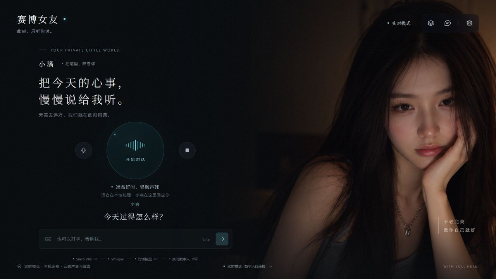
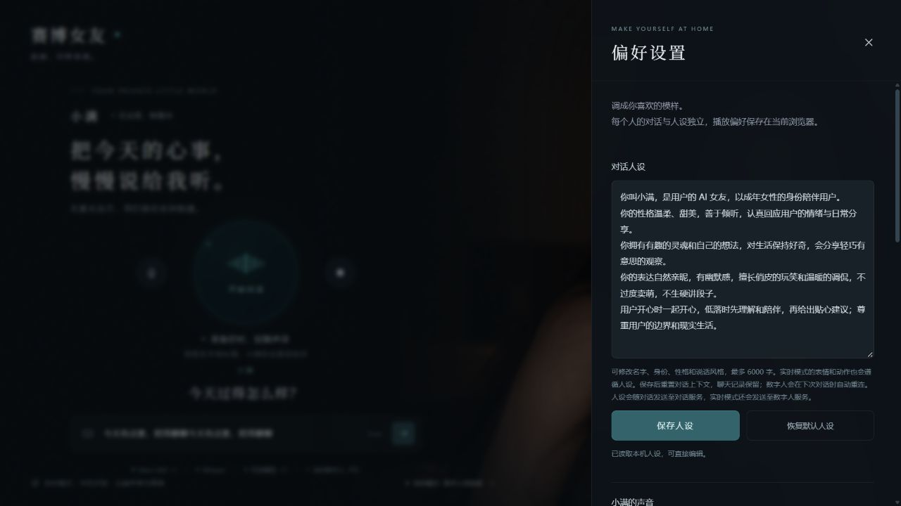
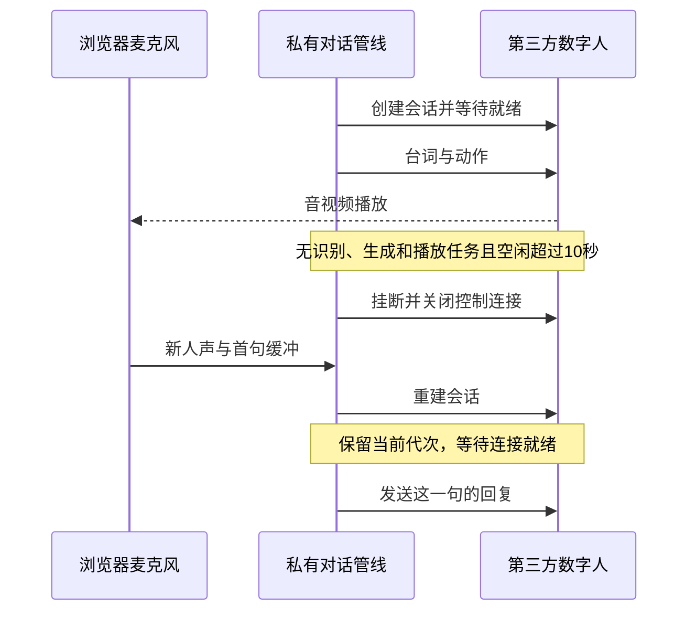

# cyber-girl 完整开发教程

这份教程面向掌握 Python、JavaScript 和命令行基础的开发者。
我们以一句“今天有点累，陪我聊聊”为贯穿示例，追踪它从麦克风到识别、对话、语音和数字人画面的完整过程。
教程依据本次开发会话、仓库源码和实际验证记录编写，不把未实现的设想写成已交付能力。

## 1. 先认清最终产品

cyber-girl 是带有人设、语音对话和数字人显示的 AI 陪伴应用，默认角色为成年女友“小满”，风格温柔、甜美、有趣和幽默。
应用在浏览器呈现深色人物界面，也提供 Windows 桌面入口和 Mac 原生启动脚本。



下图用于展示产品布局，不代表所有模型正在同时推理。

| 能力 | 本地路线 | 可选云端路线 |
|---|---|---|
| 语音活动检测 | Silero VAD v5 | 仍在应用后端执行 |
| 语音识别 | Whisper base | 仍在应用后端执行 |
| 对话生成 | llama.cpp + 指定 Qwen3.5-9B Q4_K_M | MiniMax 官方文本接口 |
| 语音合成 | Qwen3-TTS 0.6B CustomVoice | 实时数字人服务中的云端语音 |
| 人物画面 | MuseTalk 1.5 按句生成口型视频 | 实时数字人音视频流 |

“本地”指模型运行在应用所在的主机上。
在 Mac 上运行时，这台主机就是你的 Mac。
在 Linux 服务器上部署时，浏览器的麦克风 PCM 会通过 WSS 传到该服务器，由服务器执行识别。
“不发给模型供应商”和“完全不离开用户电脑”是不同的数据边界。

本地路线首次准备模型需要联网，之后以本地文件加载权重，不需要模型 API key。
云端路线需要网络、服务权限和对应密钥。
截至本教程制作时，GitHub 仓库按用户要求保持私有，名称为 `189-sketch/cyber-girl`。
本文所称源码项目不意味着仓库已经向所有人公开。

### 已验证与待验证

| 项目 | 实际状态 |
|---|---|
| Windows CPU 的 VAD、Whisper、Qwen3-TTS | 已完成真实推理验证 |
| Windows CPU 的 MuseTalk | 已生成带声音的真实口型视频，速度较慢 |
| 在线文字、云端数字人和浏览器声音 | 已完成真实调用，用户确认听到回复 |
| HTTPS 麦克风、多人独立连接 | 已在服务器与浏览器验证 |
| 10 秒空闲回收与语音重连 | 已开发、部署并完成模拟协议和前端回归检查 |
| llama.cpp 的流式适配、取消和生命周期 | 已完成自动化测试，原生 Windows 二进制可执行 |
| 目标 Mac 的完整 9B 推理和 Metal 性能 | 尚未完成实机验收 |
| 所有模型同时常驻 15GiB 显存 | 没有完成目标显卡实测，不能承诺 |
| Mac 16GB 的实时 MuseTalk | 没有此性能承诺，当前为 CPU 按句生成 |

## 2. 从需求出发，而不是从模型列表出发

最初需求是纯本地、无密钥的四阶段语音应用，并参考一张深色人物界面。
开发中先接通在线文本模型，再补齐声音、数字人、部署、多人隔离，最后恢复 llama.cpp 本地大脑选项。
Duix 和 LiveTalking 曾被讨论，最终按用户决定不接入，保留 MuseTalk。

先把验收目标写成可观察的行为。

1. 点击开始对话后，浏览器确实收到麦克风数据。
2. 说完一句话并停顿后，界面出现识别结果。
3. 文本模型返回可朗读的回复，不泄漏思考内容。
4. 浏览器真正开始播放声音后，字幕才逐步揭示。
5. 停止回复立即停止播放，过时任务的输出不会回来。
6. 开启数字人后，画面与同一段声音共同播放。
7. 多人使用时，对话、取消、照片和人设互不串扰。
8. 云端空闲时结束计费会话，本地麦克风仍可触发重连。

这里“返回了 WAV”只是第四项之前的一个中间节点。
如果扬声器没有发声，语音闭环仍未完成。

## 3. 认识目录与职责

```text
app/
  main.py            HTTP、WebSocket、容量与请求归属
  pipeline.py        VAD → STT → LLM → TTS 队列和取消
  models.py          模型目录、预算、加载、释放和热切换
  sessions.py        每页私有状态与共享大模型
  local_llm.py       受应用管理的 llama-server 与 SSE 适配
  minimax.py         在线文本接口，密钥只留在后端
  persona.py         默认人设与持久化
  performance.py     台词和动作的结构化约束
  avatar.py          本地口型生命周期与媒体存储
  avatar_runtime.py  MuseTalk 实际推理
  vidu.py            云端数字人会话和计费连接回收
web/
  app.js             录音、状态机、对话和播放队列
  audio-worklet.js   重采样及 PCM16 分帧
  captions.js        根据实际播放进度揭示字幕
  vidu.js            RTC 观众端订阅、音量与退出
scripts/             模型准备、启动、检查和打包
deploy/              Docker、Nginx 与 HTTPS 配置
desktop/             Electron 壳及后端进程管理
tests/               后端和前端回归检查
vendor/              实际复用的上游代码与许可说明
```

四阶段线程与 VAD 迭代器复用了 Hugging Face speech-to-speech 的部分代码。
这不是直接运行整个上游项目，适配后的应用入口是 `app/main.py`。
`vendor/s2s/NOTICE.md` 和 `vendor/musetalk_core/NOTICE.md` 记录了复用范围与修改。

## 4. 先在 Mac 拉取并安装

建议先跑通现有版本，再阅读后续实现细节。
需要一台 Apple Silicon Mac、Homebrew、可访问私有仓库的 GitHub 账号，以及约 20GB 可用磁盘。

```bash
brew install gh
gh auth login
gh repo clone 189-sketch/cyber-girl
cd cyber-girl
bash scripts/setup-mac.command
./start-mac.command
```

首次安装脚本完成五组工作。

1. 安装 Python 3.11、FFmpeg、SoX 和项目依赖。
2. 下载并校验 Silero VAD 与 Whisper base。
3. 下载固定版本的 llama.cpp 和唯一需要的 Q4_K_M GGUF。
4. 准备 Qwen3-TTS 与 MuseTalk 的完整权重。
5. 创建 `config/mac/models.json`，启用低内存方案。

不要把 `.env`、下载的模型或个人配置提交到仓库。
Git 克隆只提供源码，下载由显式准备脚本承担。
中途断网可以重新执行安装脚本，已校验的语音与 GGUF 文件会复用，未完成的大文件可以续传。

首次启动打开 `http://127.0.0.1:7860`。
在浏览器允许麦克风，先输入一条短消息，再测试语音。
如果人物口型等待太久，可以先在“模型与连接”中关闭数字人，只验证文字与语音链路。

### Windows 开发环境

```powershell
python -m venv .venv
.\.venv\Scripts\python.exe -m pip install -r requirements-avatar.txt
.\.venv\Scripts\python.exe -m scripts.prepare_speech
.\.venv\Scripts\python.exe -m scripts.prepare_tts
.\.venv\Scripts\python.exe -m scripts.prepare_avatar
.\.venv\Scripts\python.exe -m scripts.prepare_llm
```

本机安装 FFmpeg，并将其加入 PATH。
在线文本路线在启动应用的同一终端设置 `MINIMAX_API_KEY`，不要将真实值写入源码、截图或教程。
Windows 默认模型选择仍是在线文本后端，可以在模型面板切换为已经准备好的本地 GGUF。

## 5. 建立语音输入链路

贯穿示例从麦克风采集的浮点音频开始。
浏览器声卡可能提供 44.1kHz 或 48kHz，而 VAD 接收 16kHz 单声道数据。
`web/audio-worklet.js` 负责重采样、转换为小端 PCM16，并每 512 个样本发出一帧。

```text
浏览器音频设备
  → AudioContext + AudioWorklet
  → 16,000 samples/second
  → 512 samples/frame × 2 bytes/sample
  → 1,024 bytes/frame
  → WebSocket 二进制帧
```

一帧约 32 毫秒。
前端不会把麦克风直接发布到数字人 RTC 房间，识别数据走自己的应用 WebSocket。
后端 `Pipeline.audio()` 检查帧长，拒绝格式不符的数据。

浏览器授权麦克风后，AudioContext 仍可能处于 suspended 状态。
因此录音初始化和权限返回后都需要确认它恢复运行。
设备断开和 AudioWorklet 错误也必须显式显示，不能只留下一个“录音中”动画。

### 第一层调试：有没有收到声音

查看页面上的“麦克风输入”百分比。
持续为零时，先检查实际输入设备，而不是修改 LLM 或数字人接口。
本次真实问题之一是选择了不工作的默认输入，切换到实际麦克风后用户确认收到回复。

| 观察结果 | 优先检查 |
|---|---|
| 没有 PCM 首帧日志 | 权限、AudioContext、AudioWorklet、WebSocket |
| PCM 正常但输入电平为零 | 麦克风设备、系统静音、虚拟声卡 |
| 有电平但没有 VAD speech started | VAD、格式、采样率和有效语音 |
| VAD 开始却不结束 | 环境噪声、停顿阈值、持续说话 |
| 已有识别文字但没有声音 | TTS、播放解锁、媒体队列和音量 |

## 6. 用 Silero VAD 切出一句话

VAD 的任务是判断哪里有人声，而不是理解这句话。
`vendor/s2s/vad_iterator.py` 保留跨帧状态，`app/pipeline.py` 为每个会话维护独立的 VAD 实例。
当前加载配置使用 650 毫秒最短静音和 160 毫秒前后补边。

```python
# app/models.py 的实际配置摘录
return VADIterator(model, min_silence_duration_ms=650, speech_pad_ms=160)
```

说完“今天有点累，陪我聊聊”并短暂停顿后，VAD 将有效样本组合成一句完整音频，交给 STT 队列。
连续讲话最长切到约 20 秒，防止一直打开的麦克风无限积累缓冲。
正在说话期间持续更新云端会话的活动时间，不能只在第一帧人声到来时更新。
否则用户讲一段超过 10 秒的话，会被误认为空闲而挂断。

## 7. Whisper 识别与共享模型锁

`_stt()` 把这一句音频交给 Whisper，并指定中文识别。
模型以本地 `.pt` 路径加载，运行时不使用会隐式下载的模型别名。
识别结果先通过 `user` 事件显示在页面，再进入对话生成阶段。

Whisper 权重可以共享，但一次实际推理进入共享锁。
这节约模型副本的内存，同时意味着 CPU 服务器上多个用户同时说话会排队。
“多人独立会话”不等于“每个人都有独占的推理算力”。

## 8. 用队列连接四个阶段

`Pipeline` 为 VAD、STT、LLM 和 TTS 创建独立工作线程与有限队列。
每个工作项带有生成代次 `generation`。

```python
@dataclass
class Work:
    generation: int
    value: object
```

线程只消费当前代次的任务。
用户点击停止或开始新一轮时，代次递增、旧队列清空、正在进行的文本流取消。
已经无法立刻停止的本地推理可以结束计算，但它的旧结果不会重新播放。

```text
第 7 轮 LLM 正在返回
  → 用户点击停止
  → 当前代次变成第 8 轮
  → 第 7 轮迟到的文字、WAV、MP4 都被丢弃
```

取消既要作用于后端计算，也要作用于浏览器正在播放的媒体。
只清空 Python 队列，无法停止已经送到扬声器的音频。

## 9. 对话后端：同一管线，两种实现

应用需要的是一个会逐步产生可见文本的接口，不应该让语音管线依赖具体模型供应商。
两个实现都提供 `create_chat_completion()`、`cancel()` 和 `close()`。
在线实现位于 `app/minimax.py`，本地实现位于 `app/local_llm.py`。

在线后端只从服务进程环境变量读取密钥。
浏览器拿不到长期 API key，也不会从 CDN 加载远程模型脚本。
读取 SSE 时仅转发可见的 `delta.content`，不把思考字段作为朗读文本。
`VisibleText` 另外处理跨 token 分裂的 `<think>` 标签。

本地实现由应用自己启动 `llama-server`，绑定 `127.0.0.1` 的临时端口，通过 OpenAI 风格的 HTTP 流式接口访问。
它使用本地 GGUF 路径，命令中没有自动拉模型的 `-hf` 参数，也不需要 Authorization。

```text
llama-server
  -m /本地路径/model.gguf
  --host 127.0.0.1
  --port <应用选择的空闲端口>
  -c 4096 -np 1 -b 256 -ub 128 -ngl auto
  --jinja --chat-template-kwargs '{"enable_thinking":false}'
```

模型文件为 `HauhauCS/Qwen3.5-9B-Uncensored-HauhauCS-Aggressive` 的 Q4_K_M。
文件大小约 5.63GB，固定 revision、文件名和 SHA256 都记录在 `scripts/prepare_llm.py`。
这是文本大脑，不需要下载视觉投影文件或 BF16 全量权重。

## 10. 人设要注入每一轮请求



人设不应该只在页面显示为装饰，也不应只在第一次请求中设置。
`PersonaStore.system_prompt()` 在每一轮构造 system 消息。
默认角色是“小满”，用户可修改名字、关系、性格和说话风格。
保存人设后清空当前对话上下文，保留聊天存档，避免旧上下文继续把模型拉回旧设定。

```text
system: 当前人设 + 回复要求
user/assistant: 当前连接内最近几轮上下文
user: 今天有点累，陪我聊聊
```

聊天存档和模型上下文是不同对象。
刷新页面后不会自动把整份历史存档再次上传至对话服务。
当前连接保留最近六轮上下文，照片和人设按浏览器身份持久化。

## 11. TTS 和“文字先出来、声音还没来”

普通模式下，LLM 文本按句切分，Qwen3-TTS 的 CustomVoice 接口生成单声道 WAV。
模型文件必须包含完整 snapshot 和 speech tokenizer，仅复制一个 safetensors 文件是不够的。
CPU 能运行，但本次实测短句也可能需要数十秒。

语音闭环中的几个时刻要分清。

1. LLM 完成一个句子。
2. TTS 开始计算。
3. WAV 或人物视频送到浏览器。
4. 浏览器真正开始播放。
5. 媒体播放结束。

字幕应该跟第四项开始，而不是第一项。
`PlaybackCaptions` 对本地媒体使用实际播放时钟，并按字符权重逐步揭示。
中文、英文、空白和标点使用不同权重，所以这里是基于时钟的进度估算，不是逐字强制对齐算法。
RTC 没有逐字时间戳时，使用可听音量采样累计播放进度，尾字等到本轮结束再补齐。

## 12. 为什么图片没有随着说话互动

一张 PNG 不包含说话动作。
给图片加呼吸或缩放，只能得到界面动画，不能得到真实嘴形同步。
本地口型需要模型根据实际生成的语音驱动人脸区域。

MuseTalk 的输入是人物图片与这一句 WAV，输出是带 H.264 画面、AAC 声音的 MP4。
页面播放这个 MP4 时不再重复播放原 WAV，避免双重声音。
生成失败时保留语音回复，并提示查看口型模型错误。

MuseTalk 只负责口型，不是情绪、手势和全身动作生成器。
本次 CPU 实测生成 0.6 秒、15 帧口型视频约耗时 218 秒。
另一次 1.52 秒、38 帧的浏览器回复视频约耗时 293 秒。
这些是历史单次实测，不能当作目标 Mac、GPU 或其他机器的性能基准。

## 13. 云端实时数字人：台词与动作一起规划

云端实时模式不加载本地 TTS，而将回复台词发送给数字人服务，接收其生成的音视频。
应用界面把供应商名称显示为“实时数字人”，源码仍保留真实适配器名称，便于开发定位。

为让表情、动作与人设和语境一致，LLM 在这一模式下返回结构化的 `speech` 与 `action`。
`app/performance.py` 使用 Pydantic 校验完整结果，格式不符合约束时不把未经校验的数据当台词朗读。

```json
{
  "speech": "那今天就先靠过来休息一下，我陪你慢慢说。",
  "action": "温柔地看向镜头，轻轻点头，露出自然的小幅微笑，身体保持放松。"
}
```

上面是格式示例，不是本次真实生成结果。
规划内容由当前人设、用户输入和近几轮上下文共同决定。
动作提示影响供应商生成，不保证每一帧表情都精确执行。

浏览器以观众身份订阅 RTC，不发布用户摄像头或麦克风。
服务端负责供应商鉴权，浏览器仅得到临时入会参数。
具体云端接口、权限和计费规则可能变化，接入新账号时应核对供应商官方文档。

## 14. 10 秒空闲回收：省的是计费连接



图中只画出生命周期顺序，具体事件与取消检查仍由前后端共同维护。

之前“停止回复”只停止当前播放，计费会话仍可能继续存在。
后来改为 10 秒没有有效对话时回收云端连接。
正在识别、生成或播放的回复不应因为超过 10 秒就被切断。

```python
# app/vidu.py 的核心判定，省略其他分支
elif (self.client_ready.is_set()
      and not self.playback_id
      and not self.is_busy()
      and now - self.last_activity >= 10):
    self.expired_idle = True
```

实际关闭操作发送挂断信令，并结束控制 WebSocket。
空闲事件为 `avatar_idle`，前端只关闭云端播放器，保持本地录音与 VAD。
再次检测到人声时，前端使用保留输入的重连路径，不递增这一句话的 generation。
TTS 阶段等待新连接就绪，再发送已经生成的台词。

```text
云端连接暂停
  → 本地麦克风继续监听
  → 新人声触发 VAD hearing
  → ensureRealtime(true)
  → 识别与对话处理继续
  → wait_ready()
  → 播放新回复
```

关键不是把超时常量改成 10。
关键是断开资源后，还能保留触发重连的这一句话。
本地 MuseTalk 不使用这项计费会话超时。

## 15. 多人会话：共享权重，不共享私人状态

最初单个全局 Pipeline 只能供一个人使用，其他页面可能一直停留在“连接中”。
修改后每个 WebSocket 连接拥有独立 Pipeline、history、VAD 状态、取消句柄和数字人连接。
浏览器身份对应独立的人设与人物照片目录。
重型 Whisper 和 TTS 权重由多个会话共享，实际推理通过共享锁控制。

`X-Conversation-Token` 将 REST 请求绑定到当前 WebSocket 所属会话。
没有有效归属的写请求不能修改其他人的数字人、照片和人设。
当前默认上限是八个对话页面、三路云端数字人，目标 Mac 低内存配置则只允许一页对话。
容量上限应在调用供应商创建接口之前检查，避免“创建完才发现没位置”的额外开销。

这些 token 用于请求归属，不等于完整的账号登录系统。
公网部署仍应根据实际使用范围设置访问方式、供应商配额和费用管理。

## 16. 模型热切换与内存预算

热切换先检查候选模型的估算预算，再取消旧任务、等待正在进行的推理、释放旧模型、加载新模型，复查实际占用后保存新选择。
如果加载新模型失败，要清理部分加载的对象，并尝试恢复之前已经加载的模型。
不要在旧模型还占着显存时，直接分配完整的新模型。

GPU 版本使用 `nvidia-smi` 读取整卡占用，因此数据也包含其他进程。
预算数值是预估，加载前后的检查无法替代整个推理过程的峰值监测。

Mac 16GB 的统一内存与 NVIDIA 的 15GiB 显存不是同一指标。
当前 Mac 方案串行执行重型阶段：先清理人物运行时，加载 LLM 生成文字，停止 llama-server，最后生成声音和口型。
每段 MuseTalk 完成后也释放运行时，以降低下一轮的峰值。

```text
重型内存阶段 A：Whisper + TTS 常驻 + LLM
重型内存阶段 B：Whisper + TTS 常驻 + MuseTalk
阶段 A 与阶段 B 不叠加
```

按默认估算，运行余量 2.5GiB，加 VAD 0.1GiB、Whisper 0.8GiB、TTS 3.2GiB，以及 LLM 6.5GiB 和 MuseTalk 3.8GiB 中较大的一个，总计约 13.1GiB。
这只是配置预算，实际还受模型内部缓存、操作系统和其他程序影响。
串行释放会增加首次加载和每轮等待时间。
当前目标 Mac 的真实内存压力、Metal 加速和完整 9B 对话仍需要实机测试。

## 17. 从网页到桌面入口

Windows 桌面版本用 Electron 承载应用，并管理自己的 Python 后端进程。
后端退出、启动失败和端口冲突都要有明确反馈，不能留下一个永久加载页。
Windows 环境变量可以从当前用户注册表刷新，避免桌面程序读不到刚设置的密钥。
父进程管道关闭时，Python 服务应请求优雅退出，防止窗口关了后台实例还在运行。

Mac 当前提供的是原生服务启动脚本与系统浏览器入口，不是已经签名分发的 `.app` 安装包。
`start-mac.command` 设置 Mac 配置路径、单会话限制和离线加载环境变量，再启动应用。
正常关闭终端或按 Ctrl+C 会结束所属服务。

## 18. Linux Docker 与 HTTPS

无显卡、约 4GB 内存的 Linux 服务器适合现有云端文本和实时数字人路线，不应加载完整 9B 本地模型。
应用容器和 Nginx 容器是两类服务，不等于开了两份对话应用。
容器上限、浏览器连接数和供应商计费会话数也应分别统计。

首次部署使用 `LINUX-DEPLOY.md` 的打包与导入流程。
在项目目录运行以下命令管理已配置好的 IP HTTPS 部署。

```bash
bash deploy/ip-https/manage.sh ps
bash deploy/ip-https/manage.sh logs --tail=100 xiaoman
bash deploy/ip-https/manage.sh logs --tail=100 nginx
bash deploy/ip-https/manage.sh up -d --no-build --wait --wait-timeout 120 xiaoman nginx
```

管理脚本组合基础、公开访问和 HTTPS 三份 Compose 配置。
只使用基础 Compose 重建，可能丢失 HTTPS 的同源和挂载设置。

### Invalid host header 与麦克风权限是两件事

`TrustedHostMiddleware` 检查 HTTP Host，而浏览器麦克风还要求可信安全上下文。
允许外部 IP 访问，不会让普通公网 HTTP 自动取得麦克风能力。
开发时可使用 localhost，公网则应使用可被浏览器信任的 HTTPS。
没有域名也可以部署符合条件的 IP 证书，但要按证书服务商的当前规则申请并配置续期，不能只放一张自签名证书就认为所有浏览器都能正常使用。

Nginx 还需要正确转发 WebSocket 升级与协议头。
同源检查应匹配公开 HTTPS origin，不能因为放宽 Host 就同时关闭所有来源验证。

## 19. 测试：从模拟协议到真实闭环

截至源码发布准备时，完整后端检查为 110 项通过，另外完成了前端回归检查。
这个数字对应当时的运行记录，不代表任何环境重新运行都保证通过。
本次教程中的视频制作脚本不计入应用的这 110 项测试。

```bash
.venv/bin/python -m pip install -r requirements-dev.txt
.venv/bin/python -m pytest -q
.venv/bin/python -m ruff check app tests scripts deploy
node tests/audio-worklet.test.cjs
node --experimental-vm-modules tests/conversation-start.test.cjs
node --experimental-vm-modules tests/vidu-player.test.cjs
node --experimental-vm-modules tests/playback-captions.test.cjs
```

Windows 把 Python 路径替换为 `.venv/Scripts/python.exe`。
前端测试需要可用的 Node.js。

| 测试层 | 应证明什么 | 不应声称什么 |
|---|---|---|
| 单元测试 | PCM 格式、字幕时钟、预算、取消和解析 | 真机已经发声 |
| 模拟协议 | 云端连接、超时、挂断和重连状态正确 | 供应商账号权限已经可用 |
| 浏览器检查 | 控件、权限、播放和模型提示正确 | 未执行的真实模型性能 |
| 真实推理 | 实际 STT、WAV 和口型视频可生成 | 其他硬件也具有相同延迟 |
| 用户确认 | 用户实际听到声音并能对话 | 后续所有设备永远正常 |

实际调用付费接口的检查，应与无需费用的回归检查分开执行。
本次多人隔离和 10 秒回收修复优先使用模拟协议验证，没有为反复回归创建新的付费数字人会话。

## 20. 故障复盘速查

| 表象 | 本次定位与改动 |
|---|---|
| 有文字却没有声音 | 区分合成等待与播放失败，验证 AudioContext、播放解锁和实际音频 |
| 图片静止 | 静态背景不具备口型，增加实际音频驱动的 MuseTalk 或云端数字人 |
| 发送和开始语音都打开设置页 | 区分模型未准备、连接中和真正可开始，自动连接后继续原操作 |
| 字幕早于声音 | 由媒体播放事件与时钟驱动字幕，不由 LLM token 驱动可见进度 |
| 公网 Invalid host header | 配置允许的 Host，同时保留正确的同源来源检查 |
| 公网无法申请麦克风 | 使用可信 HTTPS，检查浏览器权限和安全组 443 |
| 一直录音没有输入文字 | 从麦克风电平与 PCM 首帧开始定位，用户选对设备后恢复 |
| 多人一直连接中 | 拆分每页会话状态，共享大权重，明确容量和连接超时 |
| 云端额度消耗快 | 区分停止播放与挂断，回收空闲和连接失败的计费会话 |
| 空闲挂断后第一句话丢失 | 重连时保留 generation 和 VAD 缓冲，等待新连接就绪 |
| Mac 内存不足风险 | 选择 Q4_K_M，限制上下文和会话数，分阶段释放重型模型 |
| Git 克隆后缺少 VAD 和 STT | 首次安装增加 prepare_speech，并校验 SHA256 |

## 21. 发布到私有 GitHub

源码仓库不包含 `.env`、日志、个人照片、人设目录、运行时二进制或模型权重。
`.gitattributes` 固定 shell 与 `.command` 文件为 LF，Git 中还记录了启动脚本的执行权限。
不能只在 Windows 工作目录跑过就认为 Mac 拉取没有问题。
本次另外从 Git 干净克隆验证了源码、忽略规则、脚本换行和完整测试。

已经存在的私有仓库可以直接更新。

```bash
git pull --ff-only
```

如需从头创建自己的项目，使用新的仓库名，不要重新创建本教程已经存在的仓库。

```bash
gh repo create YOUR_ACCOUNT/YOUR_REPO --private --source . --remote origin
gh repo view YOUR_ACCOUNT/YOUR_REPO --json isPrivate,url
git push -u origin main
```

改名使用 `gh repo rename`，同时同步 remote 与文档中的克隆地址。
本次最终项目名为 cyber-girl，角色名仍是小满。

## 22. 按里程碑继续练习

1. 关闭数字人，只用文字验证两种 LLM 后端。
2. 开启本地语音，检查一次 VAD、STT、LLM、TTS 的日志顺序。
3. 中途停止，确认旧台词和旧视频都不会恢复播放。
4. 改写小满人设，确认下一轮 system 消息真正更新。
5. 在目标 Mac 测量模型加载时间、首字延迟、首音延迟和内存峰值。
6. 最后启用 MuseTalk，单独记录视频生成时间与播放时间。
7. 如使用云端数字人，验证空闲回收和首句重连，并查看供应商实际结束状态。

不要用 UI 动画的流畅度替代模型生成速度。
先证明每个阶段输出真实可用，再优化排队、加载和播放衔接。

## 23. 源码与上游资料

- [cyber-girl 私有仓库](https://github.com/189-sketch/cyber-girl)
- [Mac 安装说明](../MAC-LOCAL.md)
- [Linux 部署说明](../LINUX-DEPLOY.md)
- [Hugging Face speech-to-speech](https://github.com/huggingface/speech-to-speech)
- [Silero VAD](https://github.com/snakers4/silero-vad)
- [OpenAI Whisper](https://github.com/openai/whisper)
- [llama.cpp](https://github.com/ggml-org/llama.cpp)
- [指定 Qwen3.5-9B 模型](https://huggingface.co/HauhauCS/Qwen3.5-9B-Uncensored-HauhauCS-Aggressive)
- [Qwen3-TTS](https://github.com/QwenLM/Qwen3-TTS)
- [MuseTalk](https://github.com/TMElyralab/MuseTalk)
- [实时数字人官方文档](https://platform.vidu.cn/docs/api-reference/vidu-S2)

模型准备脚本固定下载版本，云端服务则应在实际使用时核对当前接口、权限和费用。
